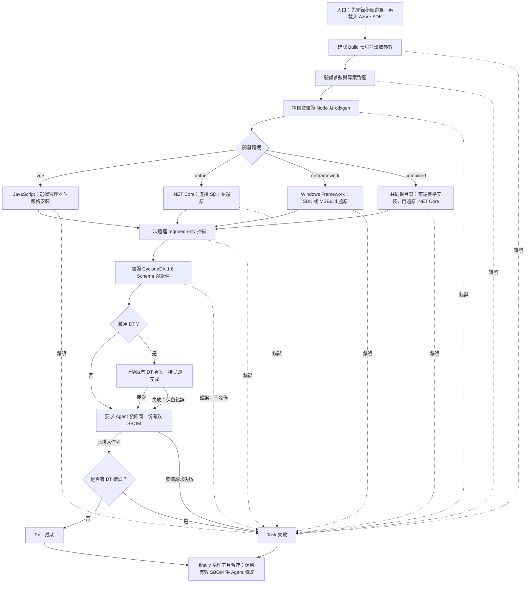

# 開發與維護

本文件帶維護者從本機建置走到實際 VSIX 驗證與發佈準備。使用者操作請先看 [README](README.md)；已驗證平台、版本與外部驗收清單集中在[相容性文件](docs/compatibility.md)，歷史工單證據不作為閱讀入口。

## 準備開發環境

使用 Node >=24、npm 與 Git；Windows 目前實測 Node24.22.1／npm11.19.1，Linux Docker 為 Node24.22.2／npm11.19.1。.NET／Framework 真實測試另需相應 SDK 或 Visual Studio；一般單元測試不需預裝整套工具鏈。

Linux 打包環境另需提供 tfx 用來判定檔案類型的 `file` 指令，Debian／Ubuntu 對應 `file` 套件。

```powershell
npm ci
npm run typecheck
npm run format:check
npm run check:source-comments
npm test
npm run package:dev
npm run test:package
```

`npm test` 編譯到 `.test-build`，用 Node test runner 執行測試並複製 Schema。`package:dev` 會先 build，再產生 `packages/local-dev-placeholder.sbom-pilot-0.1.0.vsix`；`test:package` 將 dist 與真正 VSIX 解到 Repo 外，檢查執行入口與包裝資源。執行產物、快取及日誌留在忽略目錄，不提交。

格式採鎖定的 Prettier，只作用於 `src/**/*.ts`，不排序 import；`npm run format` 修正格式。修改具名函式／方法／具名函式常數時，在實作前寫正體中文用途註解，說明責任及必要的不變條件；短匿名回呼不需逐個描述語法。`check:source-comments` 使用 TypeScript AST 找具名實作並檢查註解，仍需人工判斷說明是否有意義。

## 一次執行如何走完

`src/index.ts` 先匯入秘密輸入模組，才載入 Azure SDK。入口確認 Build 情境並建立 Task 暫存空間；`runWorkflow` 接手驗證、工具、依賴、掃描、Schema、DT 與 artifact。公開呼叫介面保留注入點，測試與實際執行入口共用工作流程。



四條依賴路徑會各自在 finally 清除所建立的認證／工具暫存，才返回共同掃描階段。合併模式先處理前端安裝根目錄，避免重複安裝 workspace 成員，再還原後端；不以合併兩份 BOM 取代一次掃描。Framework 的 SDK-style 走 dotnet，傳統 PackageReference／packages.config 走 Agent 的 MSBuild。

DT 錯誤會保留到有效成品發佈請求之後再拋出。入口發出 `artifact.upload` 時只代表請求已排入 Agent 佇列；上圖的 Task 成功不代表 Azure 已完成非同步上傳。有效檔案必須保留到工作清理，不能在入口 finally 刪除。成品請求本身失敗也必須讓 Task 失敗。

## 從哪個模組開始讀

| 維護工作 | 主要檔案 | 需要守住的行為 |
| --- | --- | --- |
| Azure 入口／輸入 | `azure-secret-inputs.ts`、`azure-inputs.ts`、`index.ts` | 秘密模組第一個 import，SDK debug 前遮罩；秘密不經 getInput |
| 參數與流程 | `config.ts`、`tool-options.ts`、`workflow.ts` | 嚴格布林、空排除、預設值、單次掃描、DT 失敗仍發佈 |
| 子程序 | `process.ts` | 不用 shell，UTF-8 串流，逾時清理程序樹，不轉印秘密輸出 |
| 工具／快取 | `tools.ts`、`node-cache.ts` | 官方下載／checksum、實際版本、完整標記與原子快取、安全 ZIP／tar |
| JavaScript 探索／版本 | `install/project.ts`、`yarn-project.ts`、`manager.ts` | workspace、唯一鎖檔、精確宣告、雜湊、管理器初始化認證與工具安裝環境分離 |
| 安裝／npm 認證 | `install/javascript.ts`、各管理器 installer、`npm-auth.ts` | frozen／immutable／ci、來源範圍、Repo 設定、實體 sourceRoot 外暫存及清理 |
| .NET 還原／NuGet 認證 | `dotnet/`、`install/dotnet.ts`、`framework.ts` | SDK 政策、官方有效來源、整個 graph、鎖檔、assets／nupkg 完整性 |
| 合併產品 | `install/javascript-projects.ts`、`combined.ts` | 共同根目錄、workspace 擁有權、單次遞迴掃描 |
| 掃描／驗證 | `scan.ts`、`validation.ts` | required-only、禁止再次 install、必要 obj/assets 例外、官方1.6 Schema |
| 網路／DT | `network/`、`dt/` | Proxy／CA、憑證、大小／逾時／redirect、有限重試、接受 token 邊界 |

`ToolContext` 只保留子工具環境與已驗證 assets／packageFiles，不保留專案來源秘密。npm 認證暫存同時檢查 Git 根目錄、共同 sourceRoot 及實體路徑；NuGet 使用實際 SDK／MSBuild 的 Configuration API，不用全域 config 取代分層設定。套件／鎖檔／資產檢查不得因改包裝器而略過。

Node 快取僅公開驗證完成的暫存安裝目錄，並行寫入者驗證勝出目錄，不刪除不完整目的地。Linux tar／Windows ZIP 預檢不得放寬 traversal 或連結限制。JSONC 解析器 `jsonc-parser` 的 ESM bundle alias、Task SDK 動態資源與相對路徑也須保留。

## 複雜處如何拆分

這次整理保留公開介面，把判斷集中到明確責任的內部函式；不是新增一層泛用工廠。Yarn 分開鎖檔世代與最近設定，專案探索分開唯一鎖檔／pnpm 格式，管理器準備分開封裝完整性／隔離安裝／實際版本。認證預檢分開 npm 優先序與 Yarn 合併／映射檢查；tar 分開記錄、PAX 與連結；網路分開憑證、代理、回應收集與請求清理。SDK 分開政策讀取、已安裝 host 與官方安裝；Framework 分開 graph 評估與還原資料驗證。

以下為同一 AST 規則估算的函式自身分支數（含初始1、條件／迴圈／catch／短路，排除巢狀函式）；用途是定位閱讀負擔，不是品質分數或驗收配額：

| 主要函式 | 整理前 → 後 | 閱讀時先看 |
| --- | --- | --- |
| `inspectYarnProject` | 41 → 13 | 世代與路徑政策的組合 |
| `inspectJavaScriptProject` | 37 → 13 | workspace → 唯一鎖檔 → 管理器 |
| `withPackageManager` | 39 → 19 | 選擇指令及暫存生命週期 |
| `checkProjectAuthentication` | 35 → 19 | 設定探索，細節交給各格式檢查 |
| `validateNodeTar` | 39 → 5 | 記錄覆寫與整體連結驗證 |
| `sendHttpRequest` | 14 → 5 | 單次請求與統一 finally 清理 |
| `prepareDotnetSdk` | 28 → 8 | 系統 SDK → 完整快取 → 官方安裝 |
| `restoreFrameworkProject` | 34 → 17 | 評估 → 還原／鎖檔保留 → 資料完整性 |

`runWorkflow` 的模式分派改用具名的 `installDependencies` 與明確分支，讓主流程直接對應上方圖；各路徑的 sourceRoot／認證選項與注入 installer 優先序不變。重新計算清單可用 `node scripts/check-source-comments.mjs --inventory`。新增 helper 的中文註解說明責任與不變條件；原有測試仍從實際呼叫介面驗證行為。

## 依變更選擇驗證

先完成型別、格式、中文說明、全測試及封裝檢查，再跑受影響的真實流程。測試的介面應與呼叫者一致；避免新增只重述實作的測試，或沒有需要就重跑所有歷史下載矩陣。

| `npm run` 命令 | 主要用途 |
| --- | --- |
| `test:smoke`／`test:options-smoke` | Vue/npm、required scope、預設／排除／版本與鎖檔 |
| `test:smoke:pnpm`／`test:smoke:yarn` | workspace、各世代／格式、精確版本與嚴格安裝 |
| `test:smoke:npm-auth` | loopback Bearer／Basic、公開並存、映射、來源隔離、清理；可用 `-- --scenarios=npm,pnpm12,yarn-pnp` |
| `test:smoke:dotnet`／`test:smoke:framework` | SDK6／9／10、傳統三格式、鎖檔、assets／nupkg |
| `test:smoke:nuget-auth` | loopback v3、四種格式與整個來源 graph；Linux 用 `-- --formats=dotnet` |
| `test:smoke:combined` | 共同根目錄與不同前端管理器、一次掃描 |
| `test:final` | 解包後實際執行入口、DT 接受／拒絕、同一成品、本機 adapter 故障 |

以上外部流程會下載真實工具並執行專案 install／restore。範例鎖檔只在明確的 fixture 維護模式更新，例如 `test:smoke:yarn -- --refresh-fixtures`；一般 Task 與驗證不自動修正輸入。

## 最終 VSIX 驗收

先執行 npm test、package:dev。`npm run test:final` 將目前 VSIX 解到 Repo 外，執行原始 handler。Windows 預設跑 npm、pnpm workspace、Yarn4 PnP、私有 .NET Core、私有前後端合併、三種 Framework 格式及成品轉接器故障；Linux 預設跑 npm、私有合併與 artifact 故障。可用 `npm run test:final -- --cases=pnpm,combined` 選擇受影響場景。

Windows 可設 `SBOM_FINAL_NODE20` 為實際 Node20 執行檔，讓 npm 場景使用該入口。單獨入口檢查：

```powershell
node scripts/verify-package.mjs --node <absolute-node20-path> --node <absolute-node24-path>
```

此檢查在 Repo 外驗證 dist/VSIX 位元組一致、四模式／雙 handler、SDK 動態資源載入／glob／子程序、秘密先遮罩、runtime 告示及套件內 Markdown 連結。`node scripts/acquire-handler.mjs 20` 可下載並校驗 Windows 測試用 Node20，不會替 Agent 安裝 handler。

final-smoke 使用真正本機 HTTP npm/NuGet/DT 服務，讀取 artifact.upload 命令，確認檔案在退出後仍存在且與 DT 接收位元組相同。發佈故障僅用開發 preload 讓真實 SDK adapter 拋錯，不修改產品入口。這些是本機證據，**不是 Azure 成品上傳／下載或 Agent 非同步失敗傳播的驗收**。忽略的 `.smoke/final-delivery/evidence.json` 和去除 setsecret 命令的日誌記錄版本／VSIX及SBOM SHA-256，不保存秘密。Yarn 正常安裝會格式化部分 workspace package.json，測試比較其值；鎖檔／來源設定仍逐位元組比較。

Linux 冷啟動必須用沒有 SDK 的 Node 映像與全新 volume；已有同名資源時換新名稱保存舊證據：

```powershell
New-Item -ItemType Directory -Force .smoke | Out-Null
git archive --format=tar HEAD -o .smoke/final-source.tar
$sourceArchive = (Resolve-Path .smoke/final-source.tar).Path
docker volume create sbom-pilot-final-repro
docker run --name sbom-pilot-final-repro `
  --mount type=volume,source=sbom-pilot-final-repro,target=/work `
  --mount "type=bind,source=$sourceArchive,target=/source.tar,readonly" `
  --workdir /work `
  node:24-bookworm@sha256:e7add2a490bb17d97b485b8641bd88455fff7839ade0f5eba493c3508124d413 `
  sh -c 'tar -xf /source.tar -C /work && if command -v dotnet; then exit 1; fi && npm ci && npm test && npm run package:dev && npm run test:package && npm run test:final'
docker inspect sbom-pilot-final-repro --format '{{.State.Status}} {{.State.ExitCode}}'
docker cp sbom-pilot-final-repro:/work/.smoke/final-delivery/evidence.json .smoke/final-linux-evidence.json
```

首次 combined 由官方 dotnet-install 安裝 SDK10.0.101，再真實還原私有 npm/NuGet、掃描及上傳到 loopback DT。Node20 Docker 可在同一 volume 使用已建置產物執行 test:package 與 test:final 的 npm 場景，工具 Node24 仍由 Task 驗證。不需特權或 Docker socket。保留資源直到證據複查，再清理指定資源。當前矩陣與 live runbook 見 [相容性](docs/compatibility.md)。

## Runtime 授權與 audit

建置依兩份 esbuild metafile 盤點 Task 入口與 SDK 的實際執行相依，目前25筆，保留每份原始授權、SDK metadata／所有非程式資源。SDK task.js 保持原套件目錄與動態 resource JSON 語意；未使用 mock-test/downloader/tool-lib 不分發。建置拒絕未解析的非 builtin SDK import。詳見 [第三方告示](THIRD-PARTY-NOTICES.md)。

`npm audit --omit=dev` 目前有一項上游 minimatch moderate advisory、兩個受影響條目（minimatch/task-lib），無相容修正版、無 high/critical；產品實際執行相依確實使用該 minimatch。未套用破壞 SDK API 的 major override。開發樹的 SDK 仍宣告未封裝的 downloader，不捏造其缺漏 ISC 告示；產品已不含該模組，原公開告示缺漏 gate 已消除。發版時重新執行 audit 並記錄結果。

## 版本與公開發佈準備

VSIX 位於 packages/local-dev-placeholder.sbom-pilot-0.1.0.vsix。package:dev 使用 public:false、Local Development 名稱與 placeholder publisher。實際 Publisher／公開 Repo URL 尚未提供，不捏造 Marketplace 連結。

確認 Publisher 權限、公開 HTTPS Repo、版本說明及 [live 驗收](docs/compatibility.md) 後設定：

```powershell
$env:SBOM_PILOT_PUBLISHER = '<actual-publisher-id>'
$env:SBOM_PILOT_REPOSITORY_URL = 'https://<public-repository-url>'
npm run package:release
```

命令只建置 VSIX，不上傳 Marketplace。正式包裝要求有效 HTTPS repository URL，拒絕內嵌帳密、query／fragment、文件佔位及保留的測試網域；缺少身分、local placeholder 或未解決 runtime 告示也會拒絕。這是 metadata 的語法與秘密檢查，實際 Publisher 權限及 Repo 公開性仍須另行確認。package.json、src/task.json、vss-extension.json 同步改版；GUID／名稱固定，Task major 影響 SbomPilot@0。更新 [CHANGELOG](CHANGELOG.md)，保存 VSIX hash、版本與證據；公開前須完成獨立程式碼審查。

外部 gate：實際 Publisher／公開 Repo、真實 Services/Server 安裝、Classic/YAML UI與工作、成品下載／失敗傳播、公司 feed／企業 Proxy/CA、arm64。SDK/workload 與 Yarn required scope 限制保持明示，未測項目保留 UNVERIFIED。
