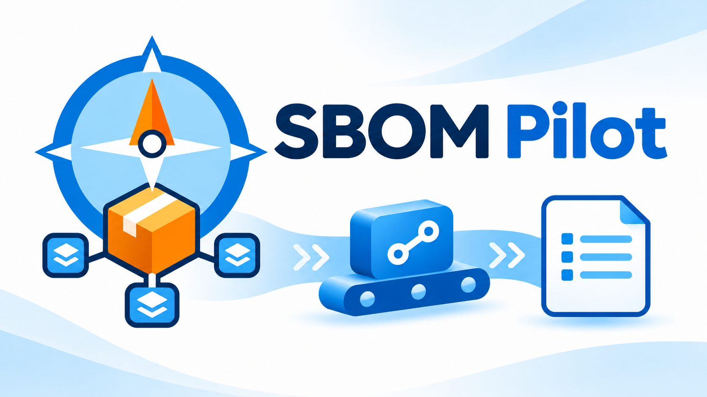

# SBOM Pilot

在 Azure Pipelines 加入一個 **SBOM Pilot — Generate & Upload SBOM** Task，即可準備 Node.js 與 cdxgen、安裝／還原專案依賴，產生產品 SBOM 與完整 SBOM，並預設執行 OSV 弱點掃描，將 SBOM 與 Markdown 報告發佈為 Build Artifact。也可將選定的 SBOM 上傳到既有 Dependency-Track（DT）專案。

## 安裝與前置條件

從 [Azure DevOps Marketplace](https://marketplace.visualstudio.com/items?itemName=LawrenceShen.sbom-pilot) 選擇 **Get it free** 並安裝至組織。0.3.1 新增 `vso.build` 建置讀取權限；組織管理員需更新擴充套件並重新同意授權。Azure DevOps Server 請由 Collection 管理員依該 Server 的擴充功能管理流程安裝 VSIX。

- 適用 Classic Build 與 YAML Build，使用 Windows／Linux Agent；Classic Release 不適用。.NET Framework 限 Windows。
- Task 提供 Node20_1／Node24 handler，最低 Agent 版本為 3.238.0。目前實測 x64；arm64、特定 Server／Agent 配對與企業網路條件見[相容性](https://github.com/lawrence8358/sbom-pilot/blob/main/docs/compatibility.md)。
- Agent 暫存與工具快取需可寫，並能存取 nodejs.org、npm registry、NuGet／專案套件與授權資訊來源。Linux 需 tar／bash，Windows 需 PowerShell。
- JavaScript／TypeScript 專案需提交 package.json 與一種管理器的一份一致鎖檔；workspace 指向共同根目錄。原生套件的編譯工具由 Agent 提供。
- .NET Core 可由 Task 準備 SDK；傳統 .NET Framework 需預裝 MSBuild >=17.8、NuGet Restore targets、相符 targeting pack／workloads。

不需另外加入 NodeTool、Corepack、UseDotNet、套件安裝或 Authenticate Task。首次執行會下載工具。

## 快速開始

.NET Core 選擇方案檔，可對整個方案執行一次還原：

~~~yaml
steps:
  - checkout: self
  - task: SbomPilot@0
    displayName: 產生交付產品 SBOM
    inputs:
      environment: dotnet
      projectPath: '$(Build.SourcesDirectory)/Product.sln'
~~~

JavaScript／TypeScript（例如 Vue、Angular）只需改成：

~~~yaml
- task: SbomPilot@0
  inputs:
    environment: javascript
    projectPath: '$(Build.SourcesDirectory)/frontend'
~~~

Classic Build：在 Agent job 選 **Add task → SBOM Pilot**，設定「開發環境」與「專案路徑」，儲存並執行。欄位與 YAML 相同。

成功後在 Build 結果的成品頁選 **SBOM**，下載產品 SBOM **sbom.cdx.json**、完整 SBOM **sbom.cdx-dev.json**，以及 **OSV弱點報告-產品.md**、**OSV弱點報告-完整.md**。Build 結果另有「OSV 弱點報告」頁籤可查看掃描結果。Task 顯示「已排入佇列」代表已要求 Agent 上傳，請以工作結果及成品頁確認上傳完成。既有 Pipeline 明確設定的 sbomFileName 仍會保留，下載腳本請依實際設定調整。

## 選擇開發環境與路徑

四種模式使用相同參數名稱，不需分別設定前端與後端路徑。

| environment | 適用專案 | projectPath |
| --- | --- | --- |
| javascript | JavaScript／TypeScript、Vue、Angular；npm／pnpm／Yarn | 專案或 workspace 根目錄 |
| dotnet | SDK-style .NET Core | .sln／.slnx／.csproj／.fsproj／.vbproj，或專案目錄 |
| netframework | Windows .NET Framework，含 SDK-style、PackageReference、packages.config | 專案目錄；選方案／專案檔時以所在目錄探索 |
| combined | .NET Core 前後端作為同一交付產品 | 包含前後端的共同根目錄 |

**JavaScript**：依 package.json、workspace 與鎖檔選擇管理器，執行 npm ci、pnpm frozen 或 Yarn frozen／immutable 安裝。缺少鎖檔、競爭鎖檔或 manifest 不一致會失敗，不自動修正。舊 YAML 的 environment: vue 仍可使用，等同 javascript。參考[管理器](https://github.com/lawrence8358/sbom-pilot/blob/main/docs/package-managers.md)、[Yarn](https://github.com/lawrence8358/sbom-pilot/blob/main/docs/yarn.md)及 [workspace 範例](https://github.com/lawrence8358/sbom-pilot/blob/main/examples/pnpm-workspace/package.json)。

**.NET Core**：選方案／專案檔時只執行一次 dotnet restore，掃描限制在還原圖內專案與 ProjectReference；方案外的舊 assets 不納入。排除規則相對檔案所在目錄，被排除成員仍可能由方案還原。參照與輸出需位於此根目錄內；跨根目錄時使用包含全部輸入的共同目錄模式。選目錄時遞迴探索並逐專案還原，不保證只還原一次。

Task 向上讀取 global.json 的完整 sdk.version、rollForward 與 allowPrerelease，缺少版本宣告時採 SDK 10.0.101；已有相容 SDK 就沿用，否則下載。保留分層 NuGet.Config，已有 NuGet lockfile 才使用 locked mode。global.json 的 sdk.paths 目前不支援；自訂 SDK／targets 與 workload 需具備可評估的 Agent 條件。

**.NET Framework**：傳統格式使用 Agent 預裝 MSBuild，不安裝整套 Visual Studio；packages.config 需可由 solution 或 repositoryPath 判定套件位置；未使用任何 NuGet 套件的傳統專案會略過還原，仍檢查 targeting pack。詳見 [.NET Framework](https://github.com/lawrence8358/sbom-pilot/blob/main/docs/framework.md)。

**前後端合併**：設定 environment: combined、projectPath: '$(Build.SourcesDirectory)/product'。Task 安裝各前端根目錄並還原 .NET Core，再以 -t dotnet -t js 單次遞迴掃描，共用排除規則，產生產品 SBOM 與完整 SBOM。啟用 DT 時對應同一產品 UUID；傳統 .NET Framework 使用獨立 netframework 模式。詳見[合併規則](https://github.com/lawrence8358/sbom-pilot/blob/main/docs/combined.md)與[範例](https://github.com/lawrence8358/sbom-pilot/blob/main/examples/combined-product/package.json)。

## 參數

| YAML 名稱／Classic 欄位 | 預設 | 用途 |
| --- | --- | --- |
| environment／開發環境 | javascript | 上述四種模式 |
| projectPath／專案路徑 | $(Build.SourcesDirectory) | 必填；專案、workspace 或合併產品根目錄，.NET 可選檔案；值可含空白，不另加內層引號 |
| nodeVersion／Node.js 版本 | 24.x | 最新符合 semver 範圍的版本，需 >=24；與 Agent handler 分別管理 |
| excludes／排除規則 | 見下方 | 相對掃描根目錄的 glob，以逗號分隔，保留花括號內的逗號；清空表示不加自訂排除 |
| specVersion／CycloneDX Spec Version | 1.6 | 產生與驗證 SBOM 的規格，不論是否啟用 DT 都適用 |
| artifactName／成品名稱 | SBOM | Build Artifact 名稱；清空沿用預設 |
| sbomFileName／SBOM 檔名 | sbom.cdx.json | 單一 .json 檔名，不含目錄；清空沿用預設 |
| runOsv／執行 OSV 弱點掃描 | true | 所有模式預設勾選，位於 DT 勾選框上方；取消時不下載或執行 OSV |
| osvVersion／OSV Scanner 版本 | latest | OSV 啟用時顯示；每次取得官方 Latest 穩定版本，也可填精確版本，例如 2.7.1 |
| osvFailOn／OSV 失敗門檻 | unknown | OSV 啟用時顯示；預設「未知」，發現任一弱點即讓 Task 失敗並略過 DT 上傳；選「僅警告」可維持 0.2.x 行為 |
| uploadToDt／推送到 DT | false | 啟用後上傳所選版本；預設為完整 SBOM（含開發套件），也可選產品 SBOM |
| dtSbomVariant／DT 上傳版本 | full | DT 每次只接收一份；選產品 SBOM 可只上傳交付產品實際部署的內容 |

預設排除規則：

~~~text
**/_Design{,Front}/**,**/bin/**,**/obj/**,**/node_modules/**,**/dist/**
~~~

可以追加 **/UnitTest/** 等專案相對 glob，不會依名稱自動排除所有測試專案。.NET 還原／掃描保留必要 obj/assets 例外，供解析間接依賴；cdxgen 自身忽略規則仍適用。

所有模式固定使用 --required-only 及 --install-deps false：先由 Task 安裝／還原，再由 cdxgen 掃描。前端及前後端合併模式另加 --no-babel，依 lockfile 的開發依賴標記過濾，避免建置設定檔中的 import 將開發工具判為 required。required scope 不等於逐項核對部署成品，Yarn workspace 可能保留上游標記為 required 的部分開發依賴，詳見 [Yarn 限制](https://github.com/lawrence8358/sbom-pilot/blob/main/docs/yarn.md)。

### OSV 弱點掃描

預設將產品 SBOM 與完整 SBOM 分別交給 [Google OSV Scanner](https://github.com/google/osv-scanner)，產生 **OSV弱點報告-產品.md** 與 **OSV弱點報告-完整.md**。完整 SBOM 包含開發套件，兩份報告可辨識開發套件帶來的額外弱點。報告包含危急／高／中／低／未知分級、CVSS 分數、可點選的 CVE 與 OSV 識別碼、套件版本及修復版本，依嚴重程度排序並列出各級數量。CVE 從 OSV 別名取得；沒有編號時標為「未提供」，缺少評分則標為「未知」，不自行推測。相同弱點別名合併成一列；相同套件的不同版本分開列出。

**0.3.0 行為變更**：預設改為發現弱點即失敗並略過 DT 上傳；要維持舊行為請選「僅警告」。0.3.1 起，DT 預設上傳完整 SBOM（含開發套件），也可選產品 SBOM；完整 SBOM 的開發套件弱點同樣依 OSV 失敗門檻阻擋建置。要調整阻擋範圍可設定門檻，或選「僅警告」。也可選危急、高、中或低作為失敗門檻；達到或高於門檻的弱點會讓 Task 失敗並略過 DT，低於門檻的弱點只發出警告。每筆弱點會以 Azure Pipelines issue 呈現：超過門檻列為 **Errors**，未超過列為 **Warnings**；每類最多列出 50 則，超出時另列剩餘筆數，完整細節見 OSV 報告。

兩份報告與 SBOM 放在同一個 artifactName 中。開啟該次 Pipeline run 的「OSV 弱點報告」建置結果頁籤即可查看結果，完整報告仍可從成品頁下載保存。無弱點也會保留報告；自訂 SBOM 檔名仍會依規則產生完整 SBOM 檔名。OSV 弱點報告與軟體組成清單是不同檔案，DT 接收所選的 SBOM。

[官方安裝文件](https://google.github.io/osv-scanner/installation/)沒有提供 npm install 方式。Task 以 Node.js 下載官方 Windows／Linux x64／arm64 執行檔，驗證 SHA-256 與實際版本，不需要為 OSV 預裝 PowerShell、Go 或額外安裝 Task。

osvVersion: latest 每次透過官方 releases/latest 解析 Latest 正式 release，該次執行固定該版本並記錄日誌；不使用預覽版，也不在失敗時默默退回舊版。指定精確版本可重現掃描工具行為；弱點資料本身仍隨 OSV 資料庫更新。未來新版若 CLI 不相容會明確失敗，可指定已驗證版本。

工具保存於 Agent.ToolsDirectory/sbom-pilot-osv，依版本／作業系統／架構分開。每次重用前驗證檔案 SHA-256、實際版本及必要 CLI 選項；完整快取不重新下載，損壞或缺失則重新取得。相同持久 Agent 可跨執行重用；雲端每次新建 VM 通常沒有先前快取，仍需首次下載。無 Agent.ToolsDirectory 時只使用此次工作暫存。

OSV 工具下載、連線、無可掃描套件或報告產生等技術失敗都會讓 Task 失敗，並仍嘗試發佈已驗證的 SBOM。啟用 DT 時，門檻不是「僅警告」會略過 DT；選「僅警告」則仍嘗試 DT 上傳，但 OSV 技術錯誤仍會在工作結尾回報失敗。DT 與成品錯誤也會保留。OSV 下載需能存取 github.com 與其 release 資產來源，掃描需連到 api.osv.dev 等 OSV 服務；Proxy／CA 條件見[相容性](https://github.com/lawrence8358/sbom-pilot/blob/main/docs/compatibility.md)。

~~~yaml
- task: SbomPilot@0
  inputs:
    environment: dotnet
    projectPath: '$(Build.SourcesDirectory)/Product.sln'
    runOsv: true
    osvVersion: latest # 或固定 2.7.1；不需反覆安裝已驗證的相同版本
    sbomFileName: sbom.cdx.json
~~~

只需要 SBOM 時設定 runOsv: false。

### DT 設定

啟用 uploadToDt 後，Classic 會顯示 DT 欄位。先在 DT 建立專案，將可上傳 BOM 的 API Key 存入 Secret Pipeline Variable。

| YAML 名稱／Classic 欄位 | 預設 | 用途 |
| --- | --- | --- |
| dtApiUrl／DT API URL | http://localhost:8081 | 必填服務根網址，可含反向代理路徑；Task 附加 /api/v1/bom；localhost 指 Agent |
| dtProjectUuid／DT Project UUID | 無 | 必填既有專案 UUID，不自動建立專案 |
| dtApiKey／DT API Key | 無 | 必填秘密變數參照，例如 $(dtApiKey) |
| skipDtTlsCertificateCheck／略過 DT TLS 憑證檢查 | false | 進階選項；只作用於 DT HTTPS，不改變其他工具 TLS |

~~~yaml
- task: SbomPilot@0
  inputs:
    environment: dotnet
    projectPath: '$(Build.SourcesDirectory)/Product.sln'
    artifactName: CycloneSBOM
    sbomFileName: Product.cdx.json
    uploadToDt: true
    dtApiUrl: 'https://dt.company.example'
    dtProjectUuid: '<existing-project-uuid>'
    dtApiKey: '$(dtApiKey)'
~~~

成品為 CycloneSBOM/Product.cdx.json；DT 接收相同 JSON 位元組。DT 上傳成功表示 API 接受，不等待背景匯入或弱點分析。DT 失敗時仍嘗試發佈有效成品，最後 Task 回報失敗。無效 SBOM 不上傳、不發佈。

請求最多30秒，暫時網路錯誤與 HTTP 408／429／500／502／503／504 最多嘗試3次；401／403不重試、不跟隨重新導向。回應遺失時，重試可能再次提交。

### 進階設定與私有套件

| YAML 名稱／Classic 欄位 | 預設 | 用途 |
| --- | --- | --- |
| npmCredentials／私有 npm 來源認證 | 空白 | JSON 清單：registry 與 token，或 username/password；供 javascript／combined 使用 |
| nugetCredentials／私有 NuGet 來源認證 | 空白 | JSON 清單：source、url、username、password；供 dotnet／netframework／combined 使用 |
| cdxgenVersion／cdxgen 版本 | 13.6.0 | @cdxgen/cdxgen 13.x 穩定精確版本；清空用預設，準備後驗證實際版本與 CLI |
| fetchLicense／補充授權資訊 | true | 補充授權，可能額外連線；關閉不移除鎖檔已有授權，也不保證完全不連線 |
| noCache／停用 cdxgen 快取 | true | 停用 metadata 快取，不影響 npm 或 Agent 工具快取 |

認證 JSON 存入 Secret Pipeline Variables，欄位只填 $(npmCredentials) 或 $(nugetCredentials)，不要把密碼直接寫入 YAML。來源路由沿用 Repo 的 .npmrc／Yarn／NuGet.Config；npm 與 NuGet 的身分格式不同，分開設定。完整範例與來源對應規則見[私有 npm 認證](https://github.com/lawrence8358/sbom-pilot/blob/main/docs/npm-auth.md)與[私有 NuGet 認證](https://github.com/lawrence8358/sbom-pilot/blob/main/docs/nuget-auth.md)。布林欄位接受 true／false，不接受 yes、0 或空白。

## 執行日誌與問題排查

日誌以綠色階段標題顯示：

1. 開始驗證工作設定
2. 開始準備 Node.js 執行環境（可重用已驗證的快取）
3. 開始安裝 SBOM 掃描工具（cdxgen）
4. 開始安裝／還原專案依賴
5. 開始產生 SBOM（cdxgen）
6. 開始驗證 SBOM（CycloneDX）
7. 開始準備 OSV Scanner（版本與工具快取，未啟用則略過）
8. 開始 OSV 弱點掃描（未啟用則略過）
9. 開始上傳 SBOM 至 Dependency-Track（DT，未啟用則略過）
10. 開始發佈 SBOM 成品（Azure Pipelines）
11. 開始發佈 OSV 弱點報告（Azure Pipelines，有完成報告時）
12. 開始發佈 OSV 弱點報告頁籤附件（未啟用 OSV 時也會上傳標示未執行的附件）

每個子程序以單行 [command] JSON 顯示 executable、argv 與 cwd，掃描前提供設定摘要。秘密顯示為 ***，不轉印原始子程序輸出。JSON 用於核對參數，並非可直接貼入 shell 的命令。DT 上傳另列 [http] PUT 與遮罩 Header。

| 問題 | 檢查項目 |
| --- | --- |
| 工具準備失敗 | 下載來源、Proxy／CA、可寫暫存與快取、Node >=24 |
| 安裝或還原失敗 | 正確根目錄、唯一鎖檔、packageManager、global.json、SDK／MSBuild、套件來源與認證 |
| SBOM 驗證失敗 | cdxgen 版本與必要 assets；僅有檔案存在不足以發佈 |
| OSV 掃描失敗 | 官方 GitHub release 下載、版本與 SHA-256、OSV API 連線、可掃描套件；弱點是否使工作失敗依 osvFailOn 設定 |
| 找不到成品 | 使用 Build 工作，核對 Agent 上傳與整個工作結果 |
| DT 401／403／404／TLS | Key 權限、UUID、服務根網址、Agent 可達性與 CA |

工具與 DT 連線沿用 Agent Proxy／CA 設定，企業 Proxy／CA／client certificate 條件需依實際環境驗證。更完整的支援範圍見[相容性](https://github.com/lawrence8358/sbom-pilot/blob/main/docs/compatibility.md)。

[原始碼與問題回報](https://github.com/lawrence8358/sbom-pilot) · [開發與打包](https://github.com/lawrence8358/sbom-pilot/blob/main/README-Dev.md) · [MIT License](https://github.com/lawrence8358/sbom-pilot/blob/main/LICENSE) · [第三方授權](https://github.com/lawrence8358/sbom-pilot/blob/main/THIRD-PARTY-NOTICES.md)
