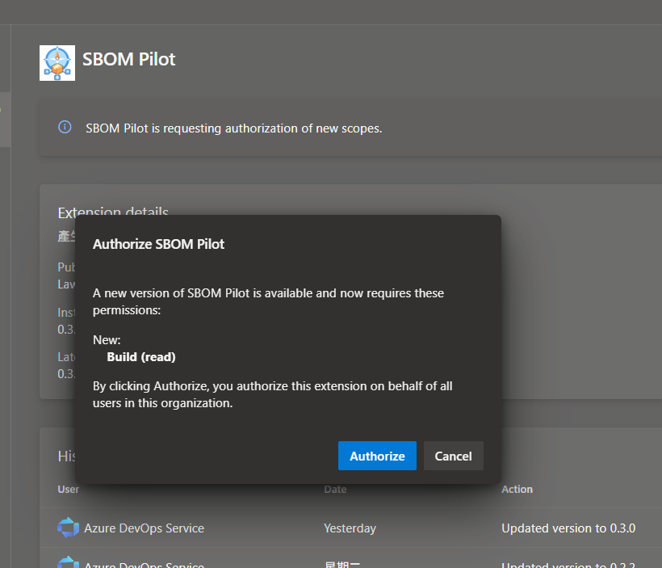
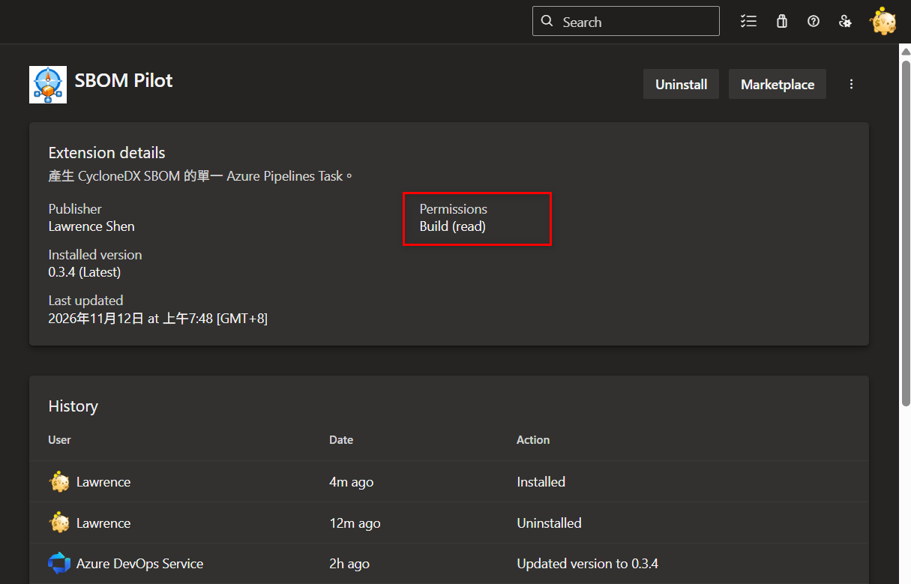
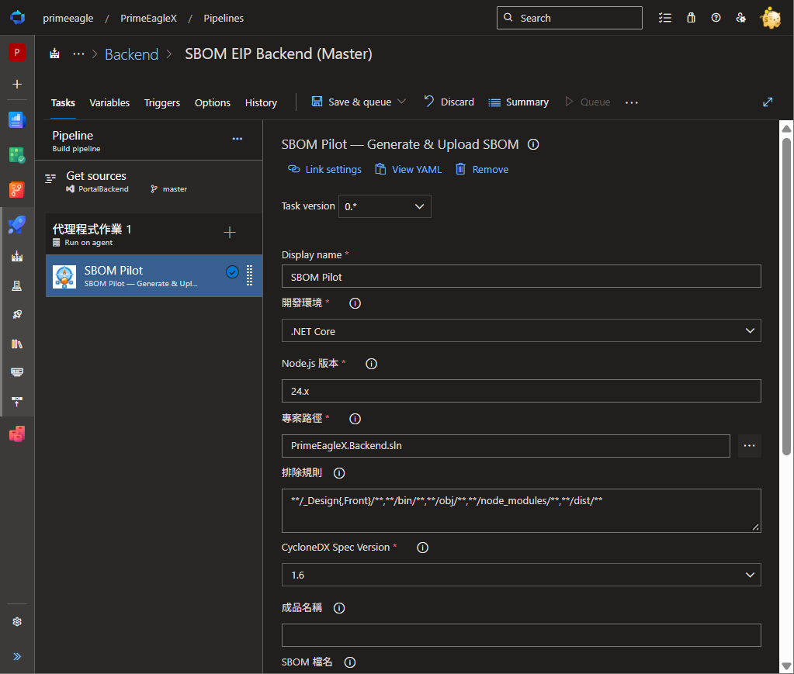
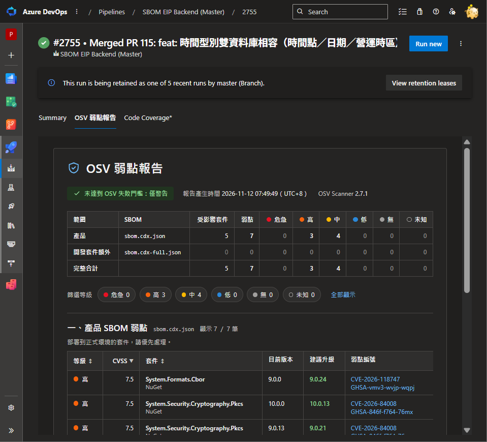

# SBOM Pilot

在 Azure Pipelines 加入一個 **SBOM Pilot — Generate & Upload SBOM** Task，就能：

- 自動準備 Node.js、cdxgen 與 .NET SDK，安裝或還原專案依賴。
- 產生兩份 CycloneDX SBOM：**產品 SBOM**（只含部署到正式環境的套件）與**完整 SBOM**（另含開發套件）。
- 用 Google OSV Scanner 檢查已知弱點，在建置結果的「OSV 弱點報告」頁籤直接查看。
- 把 SBOM 與報告發佈成 Build Artifact，也可上傳到既有的 Dependency-Track（DT）專案。

## 安裝

從 [Azure DevOps Marketplace](https://marketplace.visualstudio.com/items?itemName=LawrenceShen.sbom-pilot) 選擇 **Get it free**，安裝到組織。Azure DevOps Server 請由 Collection 管理員上傳 VSIX 安裝。

### 為什麼需要「Build (read)」權限

安裝或更新時，Azure DevOps 會請組織管理員同意擴充套件讀取建置資料（**Build (read)**）。按 **Authorize** 代表為整個組織同意一次。

需要這個權限，是因為建置結果頁的「OSV 弱點報告」頁籤要讀取 Task 在該次建置上傳的報告資料，才能把弱點畫成表格。

- **只能讀取**：可以讀取建置紀錄與該次建置的附件。
- **不能修改**：不能排入或取消建置、不能修改管線，也不會讀寫程式碼或工作項目。
- 不授權時，組織會停在舊版本，Task 與頁籤都不會更新。

授權後可在組織設定的擴充套件頁看到這項權限：

### 前置條件

- 適用 Classic Build 與 YAML Build，Windows 或 Linux Agent（Agent 3.238.0 以上）。Classic Release 不適用；.NET Framework 只能用 Windows Agent。
- Agent 需能連到 nodejs.org、npm registry、NuGet 與專案的套件來源，以及 github.com、api.osv.dev（OSV 掃描）。
- JavaScript／TypeScript 專案需提交 package.json 與一份鎖檔（npm、pnpm 或 Yarn 其中一種）。
- .NET Framework 需要 Agent 已安裝 MSBuild 17.8 以上與對應的 targeting pack。

不需要另外加入 NodeTool、UseDotNet、套件安裝或認證 Task。

## 快速開始

**YAML**：.NET Core 指定方案檔即可：

~~~yaml
steps:
  - checkout: self
  - task: SbomPilot@0
    displayName: 產生 SBOM
    inputs:
      environment: dotnet
      projectPath: '$(Build.SourcesDirectory)/Product.sln'
~~~

JavaScript／TypeScript（例如 Vue、Angular）改成：

~~~yaml
- task: SbomPilot@0
  inputs:
    environment: javascript
    projectPath: '$(Build.SourcesDirectory)/frontend'
~~~

**Classic Build**：在 Agent job 選 **Add task → SBOM Pilot**，設定「開發環境」與「專案路徑」後儲存並執行。

## 查看結果

### OSV 弱點報告頁籤

建置完成後，在建置結果頁開啟「OSV 弱點報告」頁籤：

- 最上方顯示是否超過 OSV 失敗門檻、報告產生時間與 OSV Scanner 版本。
- 總覽表列出各等級的弱點數量。
- 「一、產品 SBOM 弱點」是會部署到正式環境的套件，請優先處理。
- 「二、開發套件額外弱點」是只出現在開發套件（建置、測試工具）的弱點。
- 可依等級篩選，也可點欄位標題排序；每筆弱點附 CVE／GHSA 連結與建議升級版本。

Task 日誌也會印出直接開啟這個頁籤的連結。每筆弱點同時列在建置結果的 **Warnings** 或 **Errors**。

### 成品

在建置結果的成品頁選 **SBOM**（成品名稱），可下載：

| 檔案 | 內容 |
| --- | --- |
| sbom.cdx.json | 產品 SBOM |
| sbom.cdx-full.json | 完整 SBOM（含開發套件） |
| OSV弱點報告-產品.md | 產品 SBOM 的弱點報告 |
| OSV弱點報告-完整.md | 完整 SBOM 的弱點報告 |

自訂 SBOM 檔名時，完整 SBOM 的檔名會在 `.json` 前加上 `-full`，例如 `Product.cdx.json` 與 `Product.cdx-full.json`。

## 選擇開發環境

| environment | 適用專案 | projectPath |
| --- | --- | --- |
| javascript | JavaScript／TypeScript（Vue、Angular 等），npm／pnpm／Yarn | 專案或 workspace 根目錄 |
| dotnet | .NET Core | .sln／.slnx／.csproj 等，或專案目錄 |
| netframework | Windows .NET Framework | 專案目錄 |
| combined | .NET Core 前後端合併成一個產品 | 包含前後端的共同根目錄 |

各模式的細節：[套件管理器](https://github.com/lawrence8358/sbom-pilot/blob/main/docs/package-managers.md)、[Yarn](https://github.com/lawrence8358/sbom-pilot/blob/main/docs/yarn.md)、[.NET Framework](https://github.com/lawrence8358/sbom-pilot/blob/main/docs/framework.md)、[前後端合併](https://github.com/lawrence8358/sbom-pilot/blob/main/docs/combined.md)。

## 參數

| YAML 名稱／Classic 欄位 | 預設 | 說明 |
| --- | --- | --- |
| environment／開發環境 | javascript | 上表四種模式 |
| projectPath／專案路徑 | $(Build.SourcesDirectory) | 專案、方案檔或根目錄 |
| nodeVersion／Node.js 版本 | 24.x | 需 24 以上 |
| excludes／排除規則 | 見下方 | 以逗號分隔的 glob，相對於專案根目錄 |
| specVersion／CycloneDX Spec Version | 1.6 | SBOM 規格版本 |
| artifactName／成品名稱 | 未填時為 SBOM | Build Artifact 名稱 |
| sbomFileName／SBOM 檔名 | 未填時為 sbom.cdx.json | 產品 SBOM 檔名，只填檔名 |
| runOsv／執行 OSV 弱點掃描 | true | 取消時不掃描弱點 |
| osvVersion／OSV Scanner 版本 | latest | 也可指定版本，例如 2.7.1 |
| osvFailOn／OSV 失敗門檻 | unknown（未知） | 見下方說明 |
| uploadToDt／推送到 DT | false | 是否上傳到 DT |
| dtSbomVariant／DT 上傳版本 | full（完整 SBOM） | 也可選產品 SBOM |

預設排除規則：

~~~text
**/_Design{,Front}/**,**/bin/**,**/obj/**,**/node_modules/**,**/dist/**
~~~

需要時可追加，例如 `**/UnitTest/**`。

### OSV 失敗門檻

門檻決定「哪個等級以上的弱點要讓建置失敗」。等級由高到低是：危急（CVSS ≥ 9.0）、高（≥ 7.0）、中（≥ 4.0）、低（> 0）、無（= 0）、未知（沒有評分）。

- 任一弱點達到或高於門檻時，Task 失敗並略過 DT 上傳，但 SBOM、報告與頁籤仍會發佈。
- 預設「未知」：發現任何弱點就失敗。
- 選「危急」「高」「中」或「低」：只擋該等級以上的弱點，其餘只列為 Warnings。
- 選「僅警告」：弱點永遠不讓建置失敗。

門檻以完整 SBOM 判定，所以開發套件的弱點也會擋建置。OSV 工具下載或連線失敗時 Task 也會失敗。

### 上傳到 Dependency-Track

勾選「推送到 DT」後，填入下列欄位。DT 每次只接收一份 SBOM，預設是完整 SBOM；想只追蹤正式部署的內容，把「DT 上傳版本」改成產品 SBOM。

| YAML 名稱／Classic 欄位 | 說明 |
| --- | --- |
| dtApiUrl／DT API URL | DT 服務根網址，預設 http://localhost:8081 |
| dtProjectUuid／DT Project UUID | 既有 DT 專案的 UUID（不會自動建立） |
| dtApiKey／DT API Key | 請用 Secret Pipeline Variable，例如 $(dtApiKey) |
| skipDtTlsCertificateCheck／略過 DT TLS 憑證檢查 | 進階選項，預設 false |

~~~yaml
- task: SbomPilot@0
  inputs:
    environment: dotnet
    projectPath: '$(Build.SourcesDirectory)/Product.sln'
    uploadToDt: true
    dtSbomVariant: full
    dtApiUrl: 'https://dt.company.example'
    dtProjectUuid: '<existing-project-uuid>'
    dtApiKey: '$(dtApiKey)'
~~~

上傳成功代表 DT 已接受 SBOM，弱點分析由 DT 在背景完成。

### 私有套件來源與進階設定

| YAML 名稱／Classic 欄位 | 預設 | 說明 |
| --- | --- | --- |
| npmCredentials／私有 npm 來源認證 | 空白 | 填 Secret Variable，例如 $(npmCredentials) |
| nugetCredentials／私有 NuGet 來源認證 | 空白 | 填 Secret Variable，例如 $(nugetCredentials) |
| cdxgenVersion／cdxgen 版本 | 13.6.0 | 一般不需修改 |
| fetchLicense／補充授權資訊 | true | 在 SBOM 補上套件授權 |
| noCache／停用 cdxgen 快取 | true | 一般不需修改 |

認證格式與範例見[私有 npm 認證](https://github.com/lawrence8358/sbom-pilot/blob/main/docs/npm-auth.md)與[私有 NuGet 認證](https://github.com/lawrence8358/sbom-pilot/blob/main/docs/nuget-auth.md)。請勿把密碼直接寫進 YAML。

## 問題排查

Task 日誌依階段顯示進度，密碼與 Token 會顯示為 `***`。

| 問題 | 檢查項目 |
| --- | --- |
| 工具準備失敗 | Agent 能否連到下載來源、Proxy／CA 設定、暫存目錄是否可寫 |
| 安裝或還原失敗 | 專案路徑、鎖檔是否只有一份、SDK／MSBuild、套件來源與認證 |
| 建置因弱點失敗 | 到「OSV 弱點報告」頁籤查看弱點；依需求調整 OSV 失敗門檻 |
| OSV 掃描失敗 | Agent 能否連到 github.com 與 api.osv.dev |
| 看不到「OSV 弱點報告」頁籤 | 組織管理員是否已同意 Build (read) 權限並更新到最新版 |
| 找不到成品 | 確認是 Build 工作，並檢查整個工作的結果 |
| DT 401／403／404 | API Key 權限、Project UUID、DT 網址與憑證 |

更多支援範圍見[相容性](https://github.com/lawrence8358/sbom-pilot/blob/main/docs/compatibility.md)。

[原始碼與問題回報](https://github.com/lawrence8358/sbom-pilot) · [開發與打包](https://github.com/lawrence8358/sbom-pilot/blob/main/README-Dev.md) · [MIT License](https://github.com/lawrence8358/sbom-pilot/blob/main/LICENSE) · [第三方授權](https://github.com/lawrence8358/sbom-pilot/blob/main/THIRD-PARTY-NOTICES.md)
