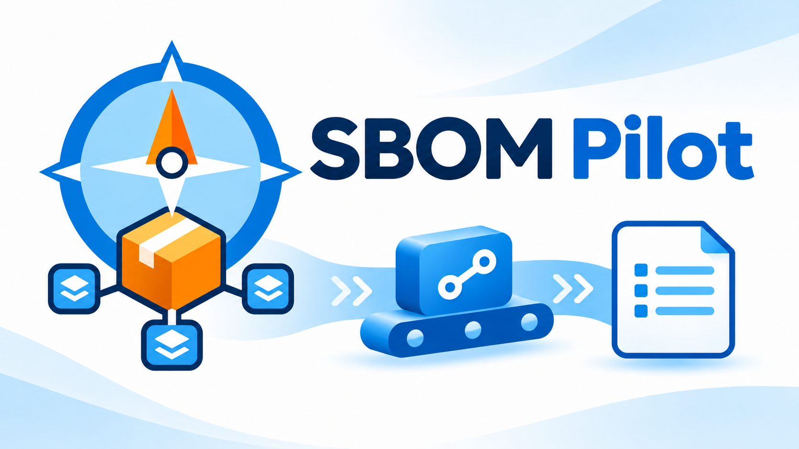

# SBOM Pilot



在 Azure Pipelines 用一個 **SBOM Pilot — Generate & Upload SBOM** Task 準備工具與依賴，產生交付產品的 CycloneDX 1.6 JSON SBOM。成品以 `SBOM` Build Artifact 提供，也可選擇把同一檔案上傳到既有 Dependency-Track（DT）專案。

上圖是產品插畫，並非實際介面截圖。此版本是本機交付候選版，尚未宣稱已上架或通過 Microsoft 審核。

## 四種專案，同一個Task

| 模式 | 依賴與使用情境 |
| --- | --- |
| JavaScript／TypeScript | Angular、Vue 等 npm／Yarn／pnpm 專案，沿用既有鎖檔 |
| .NET Core | NuGet 專案與適用的 .NET SDK |
| Windows .NET Framework | SDK-style、傳統 PackageReference 或 packages.config，Agent 預備 MSBuild／workloads |
| .NET Core 前後端合併 | 共用根目錄準備前後端依賴，一次遞迴掃描，產生一份SBOM |

Task 自行準備一般工具，嚴格執行 install／restore；私有 npm／NuGet 認證只提供給匹配來源。命令日誌顯示遮罩後的實際參數與工作目錄。DT 使用獨立原生 HTTP PUT；啟用上傳但 DT 失敗時，仍要求先交付有效SBOM再回報失敗。SBOM 是軟體清單，並非弱點分析結果或逐項部署核對。

## 開始使用

在已安裝擴充功能的 Classic Build 加入Task，或在 YAML 使用：

```yaml
- task: SbomPilot@0
  inputs:
    environment: javascript
    projectPath: '$(Build.SourcesDirectory)'
```

預設只產生成品。要送到 DT，再設定 URL、既有 Project UUID 與秘密 API Key；完整欄位、Classic 操作及私有來源範例見[使用說明](../README.md)。

## 前置條件與驗收範圍

Build-only，Classic Release 不適用。Node20_1／Node24 handler 與最低 Agent3.238.0 是來源支持的候選門檻；不等於所有 Server 年版皆可用。工具首次準備需要可用下載來源；.NET Framework 僅 Windows，傳統工具鏈由 Agent 提供。

Windows／Linux x64 有本機及 Docker 解包驗證；真實 Azure DevOps Services／Server 安裝、Classic／YAML UI、成品下載及 Agent 非同步失敗傳播仍 **UNVERIFIED**。arm64、企業feed／Proxy／CA／client certificate 亦未完成外部驗收。完整版本與限制見[相容性矩陣](../docs/compatibility.md)。

## 文件與授權

- [使用說明與輸入欄位](../README.md)
- [開發、測試與建置](../README-Dev.md)
- [Marketplace 包裝與上架操作](../docs/marketplace.md)
- [版本說明](../CHANGELOG.md)
- [第三方執行相依告示](../THIRD-PARTY-NOTICES.md)

作者 **Lawrence Shen**；採 [MIT](../LICENSE) 授權。實際 Publisher 與公開 Repo 以正式包裝時經維護者確認的 metadata 為準；本頁不預設發布帳號或捏造網址。
